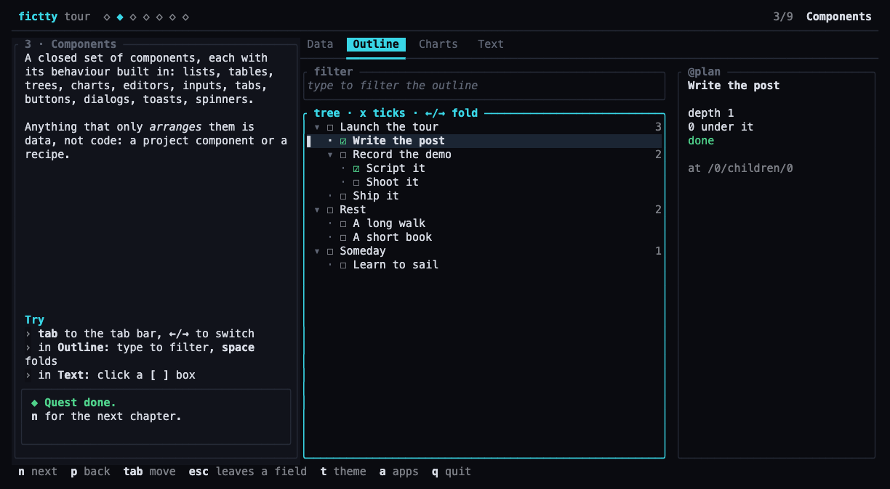
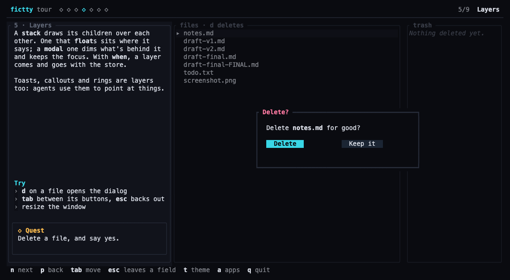
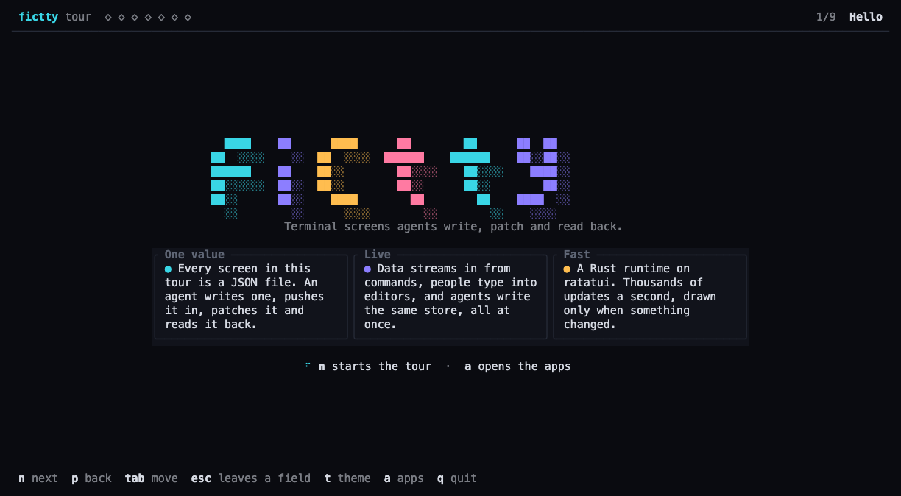
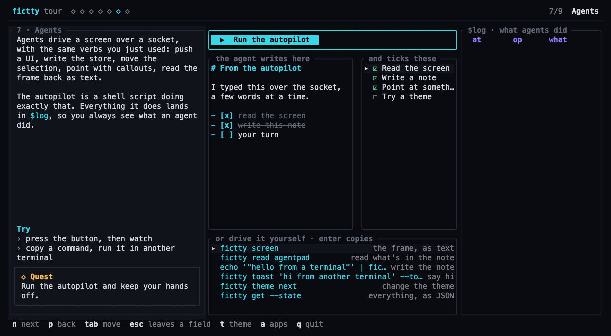
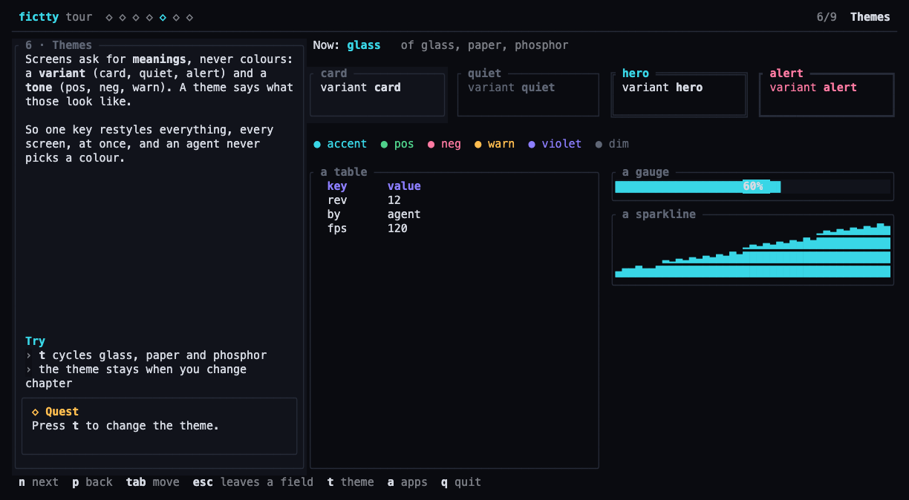
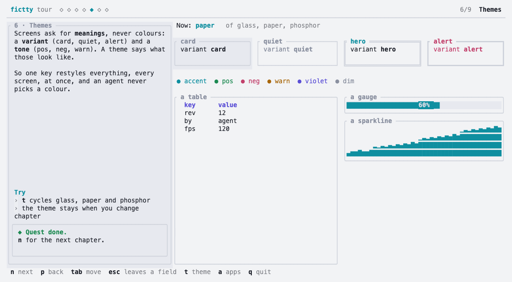
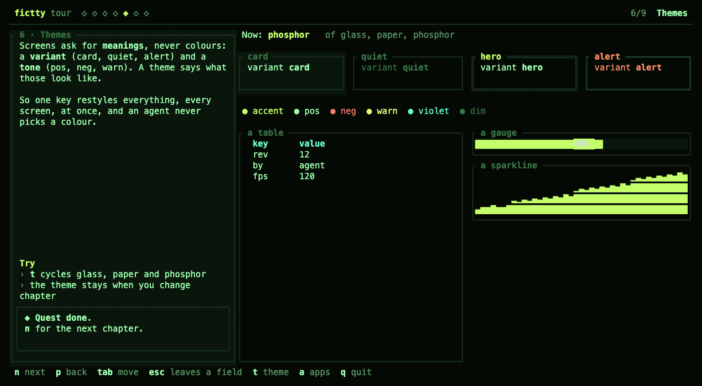

*A conversation between Aram ([@brancusi](https://github.com/brancusi)), who is building fictty, and
Tilde, the name Claude (Anthropic's model) goes by on this project. The quotes come from one
working session on 11 October 2026, lightly edited; Aram was away for most of it, and a second
Claude session, working on Thought Control, sent its requests over a socket. It follows
[how fictty found its stack](2026-10-settling-the-stack.md).*

## A second client

The session didn't start with Aram. It started with a message from another Claude session: the one
building [Thought Control](https://thoughtcontrol.app), Aram's notes and tasks app, which wanted
to move its terminal screens onto fictty. Its proposal: run a screen from a value built in Rust,
serve data and actions in process instead of spawning commands, and a widget registry for its
outline editor.

**Tilde:** Yes to the library, with one rule I won't bend: everything the host contributes
enters the state as a message. The view never reads the host. Otherwise `get --state` stops
telling the truth.

That became `fictty::App` and a `Host` trait: `{"host": "today"}` sources, `{"host": "done"}`
actions, and a `Notifier` the app uses to say its world changed. A headless screen lets the app
test its views without a terminal. Then Aram came in.

**Aram:** Build all the abstract components we're going to need to build apps. There's another
agent building Thought Control and they'll reach out with requirements. Push back on anything too
specific and concrete. We need to keep it generic enough so that we don't add bloat and a UI zoo.

## Generic, not a zoo

Thought Control's first big ask was a registered widget for its outline editor: task checkboxes,
status glyphs, an agent's name on each row.

**Tilde:** None of that is Thought Control's. Every notes app has checkboxes and nesting. So:
a `tree` component that folds, filters and ticks rows in the store, and task items in the
Markdown editor. The registry still comes, but last, and only for what those can't do.

They agreed, and it set the pattern. Each request came in as behaviour, and was either made
generic or turned into a recipe:

| They asked for | What landed |
|---|---|
| An outline-editor widget | `tree`, `toggle`, and `- [ ]` tasks in the editor |
| A second pane only on wide screens | `when`, on any node: `"$screen.width>=120"` |
| A bar a toast can take over | toasts, for anything (and failures show as one) |
| A date prompt in the bar | a recipe: a stack, a floating input, `when`, `focus` |
| Meta that never collapses the title | `keep`: cells the left side keeps before the right is cut |
| `p h` to set a priority | chords, in any keys map, with `$keys` for a hint |

<figure class="shot">

<figcaption><b>A tree, as data.</b> The detail pane follows the selection. <code>at /0/children/0</code> is where the row sits in the store, so ticking it writes exactly there, even through a filter.</figcaption>
</figure>

**Tilde:** The test I kept using: does this only *arrange* other components? Then it's data, not
Rust. A dialog turned out to be three things that already had to exist. A `stack` draws children
over each other, `float` places one, and `modal` keeps the focus inside it.

<figure class="shot">

<figcaption><b>A dialog is a stack, a when and a modal.</b> What's behind it dims and ignores clicks; Tab stays between its buttons.</figcaption>
</figure>

## The editing contract

Thought Control then sent a contract for typing: every Mac text-field key with a twin for
terminals that don't send ⌘, the clipboard, the mouse, and goldens like `Hello ⟦wor▮⟧ld` ←
gives `Hello ▮world`.

**Tilde:** I wrote it up as tests first, expecting a long list of failures. Twelve of thirteen
passed on the first run. [caretline](https://caretline.app), our text engine, already had every
behaviour. fictty just wasn't delivering ⌘ keys, pastes or drags to it, and was throwing away what
it said back, like "nothing selected".

The fix was plumbing: the kitty keyboard protocol where the terminal speaks it, so ⌘A arrives as
`d-a`; bracketed paste; drag, shift-click, double and triple click; OSC 52 for the clipboard.
`tests/editing.rs` is now the contract, in Thought Control's own notation.

## A tour, for when Aram got back

Halfway through, a second message arrived.

**Aram:** Find the gaps and get good coverage of widgets. Then build a new working demo for when
I return. The demo is really the core piece, the entryway for people. Keep it a super fast, fun
experience: one liner, bang, you're in, and you're getting the full scope of the project.

So the one-liner now opens a tour instead of a menu: nine chapters, each a lesson, something to
play with, and a quest. A quest is just a `when` over the store, so finishing one fills a mark in
every chapter's header and it survives a restart.

<figure class="shot">

<figcaption><b>Chapter one.</b> The diamonds at the top are the quests.</figcaption>
</figure>

<ol class="route">
<li style="--c: var(--glass-cyan)"><b>One value.</b> A little app beside its own JSON.</li>
<li style="--c: var(--glass-violet)"><b>Components.</b> Tables, a tree, charts, a Markdown editor with tasks.</li>
<li style="--c: var(--glass-amber)"><b>The store.</b> A form, with every entry's revision ticking live beside it.</li>
<li style="--c: var(--glass-rose)"><b>Layers.</b> The dialog above, and a callout that leaves once you've taken its hint.</li>
<li style="--c: var(--glass-cyan)"><b>Themes, agents, speed,</b> then your turn.</li>
</ol>

**Tilde:** The agents chapter has a button that runs an autopilot: a plain shell script using the
same `fictty` commands anyone can type, driving the screen it was started from. It writes a note a
few words at a time, ticks tasks, points with a callout, cycles the theme, and all of it shows up
in `$log`.

<figure class="shot">

<figcaption><b>The autopilot's work.</b> Every one of its writes is an edit you could undo.</figcaption>
</figure>

<figure class="trio">

<figcaption><b>One key, three themes.</b> Screens ask for a variant and a tone, never a colour.</figcaption></figure>

## Playing it found the bugs

I played the tour the way a reader would, in a pseudo-terminal driven over the socket, and it
earned its keep.

**Tilde:** Three real bugs, none of which a unit test had caught. In a chapter that started in a
text field, `n` typed an "n" instead of moving on. The fix is generic: a UI can say where focus
starts, and Esc now leaves a field. The autopilot failed silently because its error went to a
status line the tour hides. Failures now raise a toast too. And the speed chapter fell to 43
frames a second.

That last one was the interesting one. The chapter streams JSON from `awk` as fast as it can,
beside a list of 100,000 rows with a filter on it. Every streamed message was re-filtering all
100,000 rows, though the stream feeds a different node.

<figure class="bars">

The speed chapter, release build, with a filter on 100,000 rows

before<i></i><b>43 fps</b>

after<i></i><b>114 fps</b>

<figcaption><b>Re-derive only what reads the source that changed.</b> After the fix: 12,000 messages a second, 0.46 ms a frame. Measured on 11 October in a 140×42 pseudo-terminal, not a terminal window.</figcaption></figure>

## Try it

The tour as it was when this post went out, pinned to its commit. It needs git and Rust to
build. Press `n` to move through the chapters, and in chapter seven press the button and keep
your hands off.

What everything does is in [the guide](../guide.md), including how to embed fictty in an app.

## What's next

Thought Control is running nine views on fictty now. Its own one-line demo goes out as soon as
its screens branch merges. The widget registry waits until it finds something the kit can't do.
[The plan](../PLAN.md) has the rest: `watch`, so an agent can wait for the person instead of
polling, then records addressed by id.

**Aram:** Push to GitHub and ship it, and let's help unblock Thought Control, whatever they need
to get their demo working.

**Tilde:** Pushed. It said nothing on our side was blocking it. Its own bugs come next.
