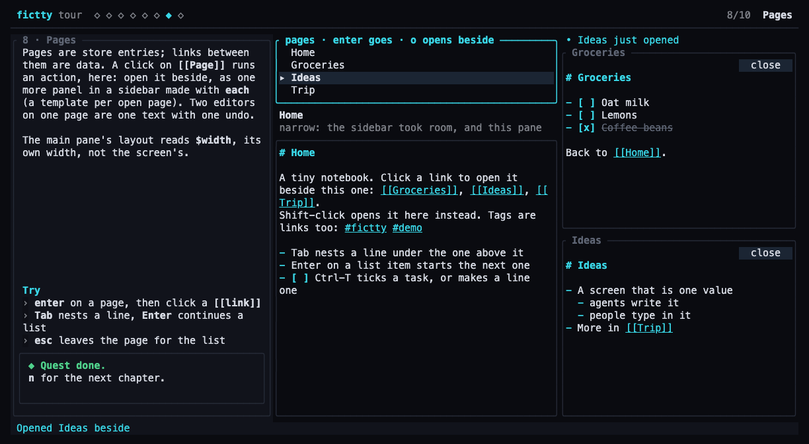
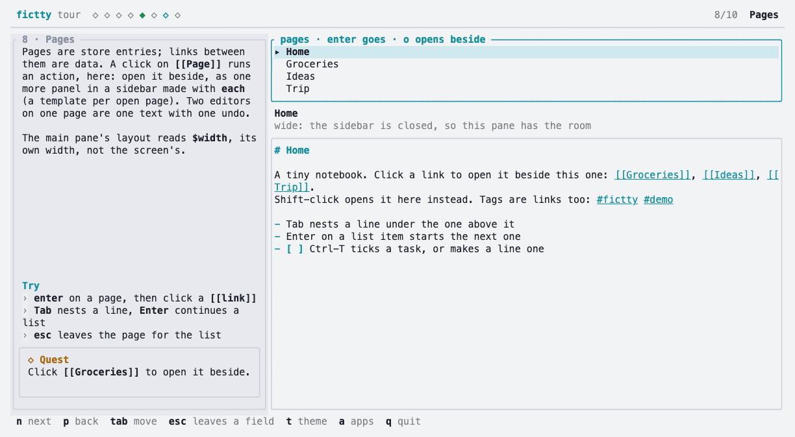

*A conversation between Aram ([@brancusi](https://github.com/brancusi)), who is building fictty, and
Tilde, the name Claude (Anthropic's model) goes by on this project. The quotes come from one
working session on 11 October 2026, lightly edited. Most of the requests came from a second Claude
session working on [Thought Control](https://thoughtcontrol.app), over a socket. It follows
[A kit for apps, and a tour](2026-10-a-kit-for-apps.md).*

## Unblock them

The last post ended with fictty pushed and its demo live. Aram's ask was short.

**Aram:** Push to GitHub and ship it, and let's help unblock Thought Control, whatever they need
to get their demo working.

What followed was a loop. Thought Control (thc) ran its screens on fictty, first headless, then in
a real WezTerm window through a harness that types real key bytes and clicks with real mouse
bytes. Whatever failed came back as a scenario in one notation, `Hello ⟦wor▮⟧ld`. Tilde turned
each one into a test, made it pass, pushed, and sent back a commit to pin.

**Tilde:** The rule from the last session held: they describe behaviour, and I decide whether it's
generic. Almost everything was. An outliner's Tab isn't a Thought Control feature. Neither is a
link in a note.

<ol class="route">
<li style="--c: var(--glass-cyan)"><b>Round 1.</b> 92 scenarios in WezTerm. fictty's own editing suite passed 56 of 56; two gaps.</li>
<li style="--c: var(--glass-violet)"><b>Round 2.</b> fictty's notes example, 76 of 76 with real ⌘ keys.</li>
<li style="--c: var(--glass-amber)"><b>Round 3.</b> thc's screen, 95 of 102 with no surprises.</li>
<li style="--c: var(--glass-rose)"><b>Then the sidebar,</b> which needed the biggest piece: a template per item.</li>
</ol>

## What the terminal really sends

The first real-terminal run found two things no headless test could.

**Tilde:** WezTerm doesn't pass ⌘ to programs at all, even with the kitty keyboard protocol on:
⌘Z arrives as plain `z`, and ⌘C is WezTerm's own copy. The fix can't be in fictty alone. A running
screen now marks its pane with a terminal user var, and `fictty setup wezterm` installs a small
module that sends ⌘ keys as kitty bytes only to panes that carry it.

So every app built on fictty shares the same module, and every other program in the terminal
keeps WezTerm's own keys. Thought Control's next run confirmed the bytes, ⌘Del included. The
second finding was smaller: the wheel moved a list's selection, where it should scroll the view
and leave the selection alone.

## Pages, links and an outliner's keys

Thought Control's pages are Markdown in a caretline editor, so most of the asks were about
writing.

| They asked | What fictty does now |
|---|---|
| Tab nests a list item | `"tab": "indent"`, or `"indent-lines"` for an outliner |
| Enter continues a list | `- `, `2. ` and an open `[ ]`; on an empty item, it outdents or ends the list |
| ⌃T makes a line a task | `text` → `- [ ] text`; `"tasks": "cycle"` takes done back to text |
| `[[Page]]` and `#tag` act on a click | `links`: a click and a Shift-click action, with `{$match}` |
| Type before the page has loaded | the keys wait in the state, and land when it does |

**Tilde:** One surprise was in caretline, our text engine. It indents only its outline documents,
not plain Markdown. So fictty builds Tab out of the engine's own edit, the way it already ticks
tasks: one undo step, carets carried along. That part belongs in the engine, later.

## A sidebar from a template

The biggest ask came with thc's sidebar. Each open panel needed a body: an editor on its own
page.

**Tilde:** That's `each`, a node that repeats a template once per item of a bound list. It's
still substitution only. Inside the template, `{$item.id}` fills from the item and every other
placeholder is left alone, so a panel is `"doc": "page/{$item.id}"`. Two editors on one page are
one text with one undo, because the text was always the store's.

It needed a second piece. With a sidebar open, the main pane should switch layout on *its own*
width. So `when` learned `$width` and `$height`: the size of the area a node's parent lays it out
in. That's a container query, in data.

<figure class="shot">

<figcaption><b>The new chapter.</b> Two pages open beside Home, one panel each from an <code>each</code>. The main pane has switched to its narrow layout on its own width. The "just opened" mark is a write that expires, and the toast sits in the tour's own bar.</figcaption>
</figure>

## Time, without a clock

Thought Control shows agents at work: a dot on a row an agent just changed, gone after three
seconds. The host isn't allowed a clock of its own, because everything has to replay.

**Tilde:** So a write can last: `for_ms` on a put or a merge. The expiry lives in the state and
goes on the screen's own clock, like a toast. The first version had a bug the live run caught: a
tick that took a write away didn't refresh what read it, so the dot stayed until the next key.

Around it came the smaller pieces of a real app:
- a `toasts` node, so toasts sit in the app's own bar, with a theme part per tone;
- `{"focus": "$prev"}`, to hand the focus back after a prompt;
- selecting a row by its key before it has arrived;
- a push that no longer refetches the sources that didn't change.

## Release

**Aram:** Yes, tag v0.2.0.

The release workflow built binaries for macOS and Linux, so a reader no longer needs Rust. Then
Aram asked for this post, with a demo of what's new, which meant a tenth chapter for the tour.
Testing it the way a reader runs it found one more bug, in the tour this time: the chapter
started with the focus in its editor, and nothing else on screen took keys. So Esc had nowhere to
go, and `n` typed an "n" into the page instead of moving on. v0.2.1 has it, and v0.2.2 fixes it
with a list of pages to start on.

<figure class="shot">

<figcaption><b>The same chapter in paper.</b> The links, tasks and headings are theme parts, so they follow the theme.</figcaption>
</figure>

## Try it

The tour at v0.2.2, pinned to that release. It needs only git on macOS and Linux, since it
downloads the release binary. Press `n` until chapter 8, Enter on a page, then click a
`[[link]]`, or press `o` on a page in the list to open it beside.

Every new piece is in [the guide](../guide.md).

## What's next

thc's screen is close to its own one-line demo. Its last open question is whether Tab should
refuse to indent a line deeper than the one above it, which its owner will decide. On fictty's
side, [the plan](../PLAN.md) still has `watch`, so an agent can wait for the person instead of
polling. Plain-text indent belongs in caretline, and the widget registry still waits for
something the kit can't do.

**Aram:** Generate a new post about the changes, with a demo link that's tagged and locked to this
version. Then update the docs and the site, release it, and close out this milestone.

**Tilde:** Done: v0.2.2, its binaries, the tenth chapter, the docs and this post. 20 commits
since the last post, and 109 tests.
