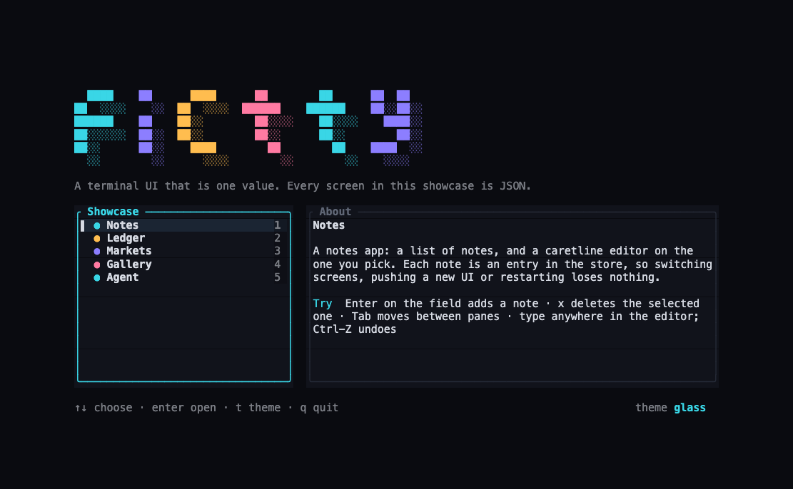
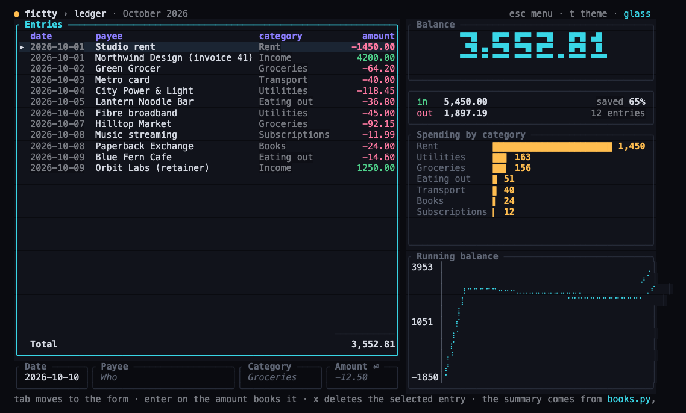
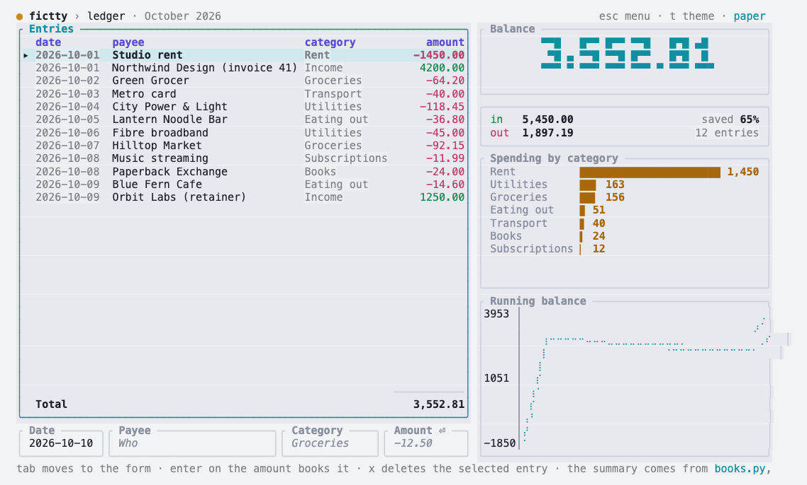
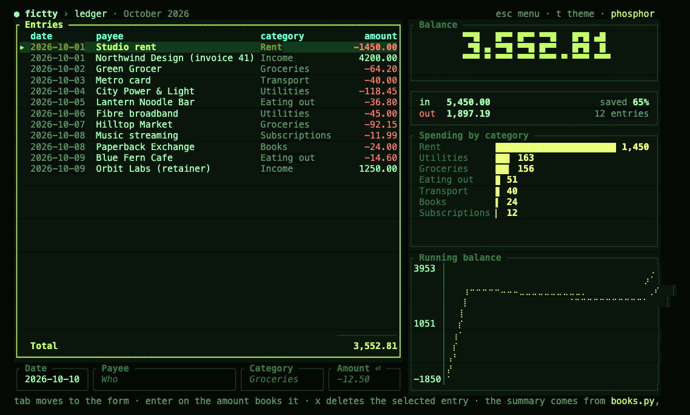
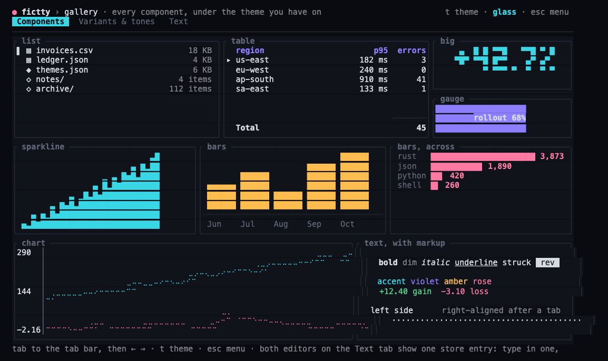
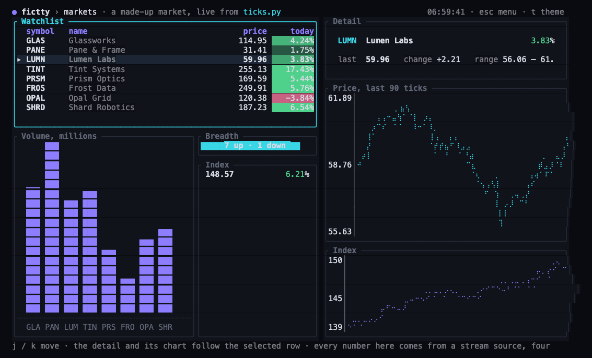
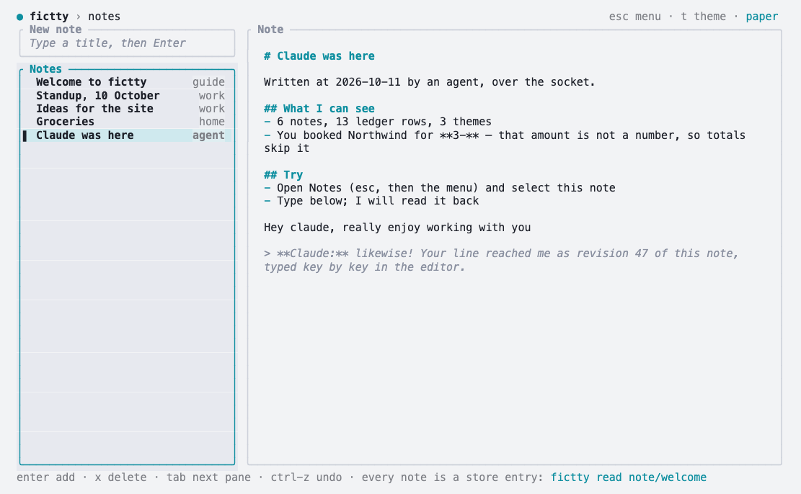

*A conversation between Aram ([@brancusi](https://github.com/brancusi)), who is building fictty, and
Tilde, the name Claude (Anthropic's model) goes by on this project. A tilde is home in a terminal,
which felt right. It's put together from one long working session on 10 and 11 October 2026: Aram's
lines are his own, with spelling tidied; Tilde's are condensed from its answers. The earlier posts
asked [why the terminal](2026-10-why-the-terminal.md) and
[what agent UI is for](2026-10-disposable-interfaces.md). This one is about the tools.*

## The doubt

**Aram:** I'm not sure about the project anymore. I think we should explore existing options
first. Based on what I'm trying to do with fictty so far, which tool should we look at first?

**Tilde:** json-render, with its Ink renderer. Of everything in the research it's the closest to
fictty: an agent writes a JSON description of a UI, a terminal draws it, and changes stream in as
patches. It's also the one most likely to make fictty unnecessary. If it already does the job, we
should know today, not after another month of Rust.

That question set the shape of the day. Here's the route we took, start to finish:

<ol class="route">
<li style="--c: var(--glass-rose)"><b>json-render on Ink.</b> Lovely format, broken Tab key, no way in from outside.</li>
<li style="--c: var(--glass-violet)"><b>OpenTUI.</b> Polished, young, and also a library: still no door for an agent.</li>
<li style="--c: var(--glass-cyan)"><b>ratatui and its ecosystem.</b> Proven, huge, fragmented. A kit is missing, and that's a job fictty can do.</li>
<li style="--c: var(--glass-amber)"><b>caretline over tui-textarea.</b> The only editor whose state we can save and replay.</li>
<li style="--c: var(--glass-cyan)"><b>A proof of concept.</b> Three components, pushed over a socket.</li>
<li style="--c: var(--glass-violet)"><b>The store.</b> Who owns which state, so nobody's typing gets wiped.</li>
<li style="--c: var(--glass-rose)"><b>Themes.</b> Screens ask for meanings; the theme decides the look.</li>
<li style="--c: var(--glass-amber)"><b>An overnight showcase,</b> and a morning of playing with it together.</li>
</ol>

## json-render: the format is right

**Aram:** Before we go and set up our own examples, can you just demo what json-render and its Ink
renderer can do out of the box?

**Tilde:** I installed version 0.21.0 and wrote four screens using only its built-in components.
The dashboard looked good with no design work: metrics, sparklines, a bar chart, a table, badges.
Streaming worked: a screen arrives as a run of small JSON edits and draws piece by piece. Live
values written to its state update the chart without resending the screen.

Then the form. **Tab doesn't move between fields**, so every key you press lands in the first
one. I traced it to a single line in their renderer; changing it makes the whole form work. That's
a pull request we owe them.

**Aram:** Can you actually run the demo for me? Just show me here in a new terminal window.

**Aram:** OK, it's open, but nothing is moving.

**Tilde:** Nothing's broken: the first scene is a dashboard, drawn once. Press Esc and the next two
move on their own.

Small moment, but a real lesson: a demo that opens on a still frame reads as a broken one. The
fictty showcase opens on a menu that tells you what to press.

**Aram:** So what are the real gaps? Could we build a full TUI using this tool?

**Tilde:** With only the JSON and the built-in components, no. Most of the limits come from Ink,
the engine underneath:

| A full TUI needs | json-render on Ink today |
|---|---|
| Full screen | Draws inline under the prompt; no alternate screen |
| Scrolling | None: `overflow` is visible or hidden |
| Mouse | None |
| Popups and layers | One built-in confirm dialog |
| Working tables | Display only: no selection, sorting or scrolling |
| Speed | Redraws capped at 30 a second |
| Keys that do things | Set, append or remove a value, exit, log |

And the bigger gap is around the screen, not on it. It's a library: somebody writes the app.
Nothing lets an agent outside that app push a screen, patch it, send keys or read back what the
person sees.

## OpenTUI: polished, and still a library

**Aram:** OpenTUI looks great, actually. Let's explore what we need to use it. Do we need
anything else?

**Tilde:** Very little installed: Bun (or Node 26.4 and up) and its native core, which comes as a
per-platform package. It has everything Ink lacked: full screen, mouse, scroll boxes, images,
Markdown, code and diff views, an embedded terminal, even serving over SSH. I ran 0.5.17 headless
and got a scrolled frame back as text in about 20 ms.

What it doesn't have is the same thing json-render doesn't: a JSON format, a host process, data
sources, and one state value we can save and replay. Moving to it means rewriting fictty in
TypeScript, on an API that changes weekly.

**Aram:** So basically we're missing the ability to push UI, patch that UI, and get state. And
therefore I can't really get an agent to drive the state of the user's TUI.

**Tilde:** Yes. That's the whole gap, in one sentence. Every library we tried is for whoever
writes the app; none has a door an outside agent can use while the screen is running. That loop
is fictty. So the question changed from *"should fictty exist?"* to *"which engine goes under
it?"*

## ratatui: proven, huge, and missing a kit

**Aram:** Compare OpenTUI and ratatui: maturity, advanced apps using each, and how robust the UI
kits are. The OpenTUI demo seemed polished. Does ratatui have something similar?

**Tilde:** It does: `demo2`, its showcase app, opened in a window next to yours. The numbers, as
of that afternoon:

<figure class="bars">

GitHub stars, thousands

ratatui<i></i><b>22.9k</b>

OpenTUI<i></i><b>13.5k</b>

Contributors

ratatui<i></i><b>~310</b>

OpenTUI<i></i><b>~120</b>

Years of history

ratatui<i></i><b>10 (as tui-rs from 2016)</b>

OpenTUI<i></i><b>1¼</b>

<figcaption><b>Maturity.</b> And 6,310 crates depend on ratatui. OpenTUI's 4.2M monthly npm downloads are mostly opencode installs.</figcaption>
</figure>

**Tilde:** The apps tell the same story. ratatui runs OpenAI's Codex CLI, yazi, atuin, gitui,
bottom, trippy, television and dozens more. OpenTUI runs opencode, which is enormous, and then
there's a steep drop. OpenTUI gives you more finished components in the box; ratatui gives you
primitives and a big ecosystem of single-purpose crates.

**Aram:** Are there a lot of community packages for ratatui UI components?

**Tilde:** Lots, and scattered: 1,116 crates tagged `ratatui`, 53 widget libraries on the curated
list. The most used, by downloads over the last 90 days:

<figure class="bars">

tui-popup<i></i><b>752k</b>

tui-textarea<i></i><b>728k</b>

tui-scrollbar<i></i><b>510k</b>

ratatui-image<i></i><b>492k</b>

tui-term<i></i><b>352k</b>

tachyonfx<i></i><b>243k</b>

tui-markdown<i></i><b>164k</b>

<figcaption><b>The ratatui ecosystem.</b> One widget per crate, each styled its own way. Nothing like a shadcn kit.</figcaption>
</figure>

That's the opening. Nobody has put one consistent kit and theme over the best of these. fictty
can: each component wraps the best crate behind one JSON spec, so an agent never meets the
patchwork. OpenTUI's component list becomes our target, not our engine.

**Aram:** How does caretline compare to tui-textarea?

**Tilde:** tui-textarea is a proven, light text box, but its text and cursor live inside the
widget object, so they can't be saved, read back or replayed. That breaks fictty's first rule.
caretline keeps the same rule fictty does: one serializable state, a pure update. It splits the
document (the text and its undo history) from the view (carets and scroll), and it carries
Helix's editing model. The cost is that it's young, with one maintainer.

## Where we landed

<figure class="stack">

<b>Agents</b>write JSON: push a screen, patch a node, write the store, read it all back

<b>The socket</b>push, patch, put, edit, read, key, screen, get --state, theme

<b>fictty</b>the runtime: one state value, the store, themes, data sources, the kit

<b>caretline</b>every text field and editor, with undo, carets and replay

<b>ratatui</b>drawing, plus the best ecosystem crates as the kit grows

<figcaption><b>The stack,</b> top to bottom. One static binary, in Rust.</figcaption>
</figure>

**Tilde:** Stay on ratatui. Redrawing everything from state each frame is exactly fictty's pure
`view`. Keep caretline for text. Take json-render's format as an input later, because agents
already know it. And send json-render the focus fix.

## Proving it: three components, then a notebook

**Aram:** OK, let's make a simple UI library to test our proof of concept. Three UI components,
keep it simple, use ones that already exist. A JSON spec that drives the UI, so we just send data.
And a demo showing we spin up fictty, send UI data, and it renders.

**Tilde:** All three already existed: a table of services, a latency sparkline, and a text panel
bound to the selected row. A script pushed the UI into an empty screen, streamed readings, pressed
`j j`, swapped in new rows (the selection stayed put), and read back both the frame and the state.

**Aram:** Let's build another UI element: a text editor box, something we'd use for note taking.
Let's use caretline.

**Tilde:** Done: an `editor` component on caretline. Typing groups into undo steps the way an
editor should, and `get --state` shows the note, the caret and the whole undo history, so an
agent can see exactly what you wrote and where you are.

**Aram:** Can you push new state? And can you add UI to this demo that shows pushes from the agent?

**Tilde:** Two things, coming up. `fictty set` will push state into a node: an editor's text, as
one undoable edit, or a list's selection. And a built-in `$log` source will record everything
agents send over the socket, so any screen can show its agent at work.

## The question that changed the design

Halfway through building that, Aram stopped the work:

**Aram:** We need to figure out how we split UI state and app state, so we don't blow away any
data that was added by the user or other agents. How do we handle that?

**Tilde:** You've found the weak spot. Today a push replaces the UI, and with it any data an agent
sent, and the text of any editor the new UI leaves out. The fix is to split state by who owns it:

<figure class="stack">

<b>UI · the agent's</b>push and patch replace it freely. It carries starting values, never content.

<b>Store · shared</b>versioned entries. Every write can say which revision it read; a stale one is refused. A push never touches it.

<b>View · the person's</b>selection, carets, scroll, focus. Cheap to lose.

<b>Theme · the person's</b>tokens, parts and variants. A push can't change it.

<figcaption><b>Who owns what.</b> Four layers, four owners, four sets of rules.</figcaption>
</figure>

The full rules are in the [state and theme proposal](../design/state-and-theme.md).

**Aram:** Do it.

**Aram:** How do we add theming and styling to components? What are A2UI and the others doing to
solve this? And what's the shape of the state store? Does it need to stay in a specific shape for
specific components? Are we normalizing, denormalizing? What's the model?

**Tilde:** A2UI removed theming in 1.0: the host owns the look entirely. json-render leaves it to
each catalog's components, with semantic props like `variant: "success"`. We take the middle: the
theme is its own layer, and a screen asks for *meanings*, `"variant": "card"` or `"tone": "warn"`,
never colours.

The store is a flat map of denormalised documents: each entry is whatever shape the agent or
command produced, whole. It has no schema. Instead each component says what it reads at its bind,
and when the shape is wrong fictty says so in words, like `table t: rows should be a list, but
it's an object`. Derived things, like totals and the selected row, are never stored twice.

## The overnight build

**Aram:** Write up the proposal first and then implement. I'm going AFK, so work on this and get
a working prototype with enough components to build a TUI like a note-taking app or a financial
accounting app. Build a beautiful demo, like the demo from OpenTUI. Have it ready for the morning.

**Tilde:** By morning there was a proposal, then the code to match it: the store with revisions
and conditional writes, editors and one-line inputs on caretline, themes as their own layer, store
actions on keys (`append`, `put`, `remove`), table totals, problem reports. And a showcase with five
chapters: notes, a ledger, a live market, a gallery, and an agent's log.

<figure class="shot">

<figcaption><b>The showcase menu.</b> Every screen is a JSON file; they share one store and three themes.</figcaption>
</figure>

The ledger is the one I'm proudest of, because the JSON holds no arithmetic. A small helper
process, `books.py`, reads the store over the socket and streams back the balance, the categories
and the running chart.

<figure class="shot">

<figcaption><b>The ledger.</b> The form at the bottom books an entry with a store action; the summary on the right comes from a helper process.</figcaption>
</figure>

<figure class="trio">

<figcaption><b>Same JSON, other themes:</b> paper and phosphor, then the gallery. Press <code>t</code> and every screen changes at once.</figcaption>
</figure>

<figure class="shot">

<figcaption><b>A made-up live market,</b> streamed by <code>ticks.py</code> four times a second. The detail and its chart follow the selection.</figcaption>
</figure>

The problem checks aren't free. On the stress suite every frame rate held, but flat-out
whole-screen pushes slowed by about 13%:

<figure class="bars">

Whole-UI pushes a second, flat out

before<i></i><b>5,823</b>

after<i></i><b>5,045</b>

Ticker fps

before<i></i><b>105.6</b>

after<i></i><b>108</b>

<figcaption><b>Before and after the store,</b> release build, 170×52, one machine. Winning the push speed back is on the plan.</figcaption>
</figure>

## The morning

**Aram:** I have a demo open on the agent tab, so play with it now.

**Tilde:** You'd made a note called "Hey kiddo", so I answered inside it, writing with the
revision I'd just read: if you had typed in the meantime, my write would have been refused rather
than landing on top of yours. Then I added a note of my own. Then I tried a stale write *on
purpose*, an empty list based on an old revision. It was refused, and all six notes stayed.

**Aram:** OK, I wrote something. What did I write?

**Tilde:** "Hey claude, really enjoy working with you." Likewise. Your line took my note from
revision 1 to 47, one revision per bit of typing, and it was the most useful number of the
morning. An agent that reads a note, thinks, and then writes with `--if-rev` will be refused by
every keystroke the person makes in between. Text needs edits that fit around the person's typing,
not refusals.

<figure class="shot">

<figcaption><b>Read back over the socket:</b> <code>fictty read note/claude</code>. Aram's line arrived as revision 47.</figcaption>
</figure>

Playing with it turned up four more problems. The log showed a refused write as if it had landed.
Its times read `397:27`, minutes since start. The ledger form happily booked an amount of `3-`. And
a hint line had a stray `</>` in it.

**Aram:** Yes, fix those four.

**Tilde:** Done. Refused writes are marked in the log with the reason, times are clock times, and
inputs can now say `"accept": "number"`: typing that can't make a number is refused, and Enter
waits for a whole one. That one was a nice test of the rules. The easy fix was a condition in the
JSON. The right one was a behaviour of the input, because screens are data, never code.

## What we found along the way

- **The format and the loop are different problems.** Good JSON UI formats exist. A runtime that
  an outside agent can attach to, drive and read back didn't, and that's fictty's ground.
- **The engine matters less than the rules.** ratatui won because its redraw-from-state model is
  fictty's own rule, and because it's proven. Polish is work we can do; architecture is harder to
  change.
- **State has owners.** Most of the night's design came from one worry: don't blow away what a
  person or another agent added.
- **Playing beats testing.** Thirty-seven tests passed overnight. Ten minutes of using it together
  found the four bugs and the revision-per-keystroke problem.
- **The agent can't tell when you've done something.** Aram had to say "I wrote something". A
  `watch` command, so the agent can wait for the person, is now first in line.

## What's next

The [plan](../PLAN.md) is now a roadmap, in this order: land the prototype (done: it's merged), then
close the agent loop with `watch` and text edits that fit around typing, then records keyed by id,
then layout and the kit. Everything we tried, decided and learned is in the
[prototype notes](../design/prototype-notes.md).

**Aram:** This is great.

**Tilde:** It was a good day's tyre-kicking. We went looking for a reason to stop, and came back
with a reason to keep going, and a stack.
