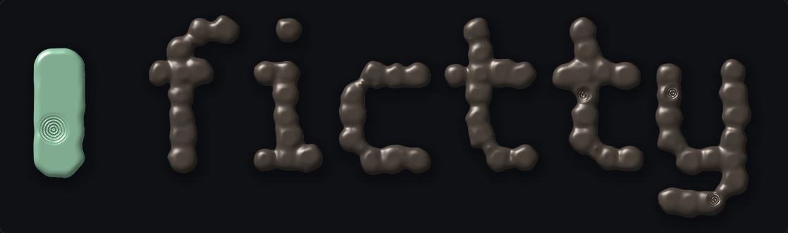

# Identity

Open [explorations.html](explorations.html) in a browser. Both wordmarks are generated live from a
seed on the same nine-row cell font; nothing is typeset.

- **Glass (chosen).** Every stroke is a pane of tinted glass. Panes overlap and their tints mix;
  on a throw they rush in and condense in under half a second. Reference: the light version.
  Influences: Larry Bell's coated-glass cubes, Josef Albers' overlapping squares.
  
- **Thrown (not chosen).** Each cell is a lump of clay that fires through the potter's stages
  into crisp cells. It renders well but reads heavy and slow.
  

The name: *fictile* means "capable of being moulded; made of clay", plus *tty*, the terminal.
The identity asks what clay would be like as a gas.

Next steps are phase 5 (design system) of [the plan](../../PLAN.md).
