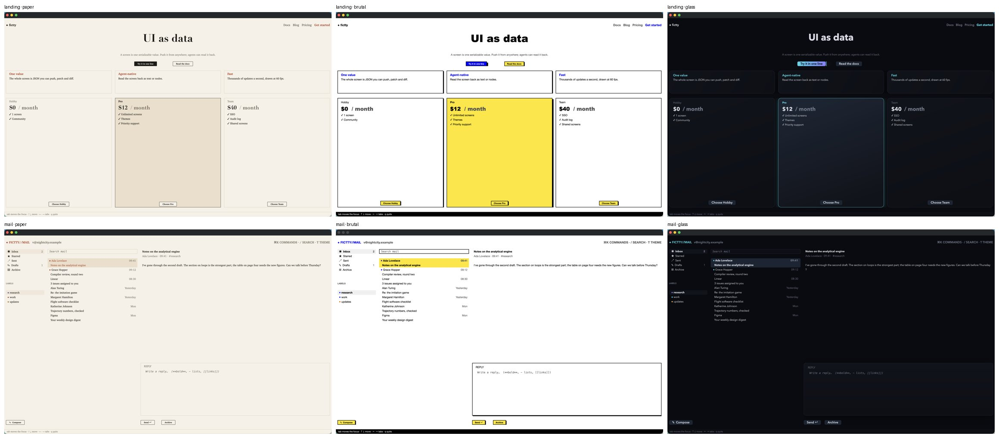

# The styling study

Step 2f of [native.md](native.md): the wringer's six themes rewritten as whole styles
(`examples/window/themes.py` writes `themes.json`), and pushed to learn which subtle things change
a screen's character most. Done on 13 October 2026, the window drawing everything step 2 built:
type roles and theme fonts, pad, radius, borders, shadows, gradients, rings, tab shapes, cards.

## What the six themes share

Every theme names the same things, so any screen wears any theme
(`every_example_screen_wears_every_theme_without_problems` checks it):

- **Type roles:** `display` and `stat` (sized in pixels on the node), and `heading`, `label`,
  `body`, `caption`, `num` (tabular) and `mono`, which fit a 24 px row. A role isn't called
  `title`: `<title>` in markup names the title part.
- **Scales:** `s1`–`s6` (4 px steps), `r1`–`r3`, `e1`–`e2`, plus a theme's own depths (`glow`,
  `lift`, `hot`, `pop`, `neon`).
- **Variants:** `card`, `quiet`, `hero`, `alert`, `bare`, now whole styles.
- **Tokens:** the palette every screen uses, the chart colours following the accents.
- **The `screen` part,** the window's own, which carries the theme's body type to every piece of
  text.

## The themes

| theme | type | edges and depth | states |
|---|---|---|---|
| night-city | Avenir Next Condensed, heavy display, Menlo | square, hairline borders, a yellow glow on what's live | the selection inverted in acid yellow; buttons outlined until focused |
| glass | Avenir Next throughout | 6–16 px radii, gradient panels, two-layer shadows | a focus ring two pixels out; a gradient on the focused button |
| paper | Charter for reading, Didot display | no shadow anywhere, hairlines, 2 px corners | underline tabs; outlined buttons that fill with ink |
| phosphor | Menlo for everything, Monaco display | square, dashed borders, glows | segmented tabs; the selection in reverse video |
| brutal | Helvetica Neue, Arial Black display | 2 px black borders, hard offset shadows with no blur | yellow buttons that go blue; a black status bar |
| soft | Avenir Next | 10–20 px radii, no borders, lavender-tinted soft shadows | pill buttons and tabs; a gradient on the focused button |

## What moved a screen's character most

1. **Type, by a long way.** The landing page in Didot reads as a magazine, in Arial Black as a
   poster, in condensed Avenir as a game, in Monaco as a terminal, with nothing else changed.
   One monospace face for everything (phosphor) changed every screen more than any colour did.
   A display face does most of the work; the UI face mostly sets the tone (a serif body slows
   the eye; condensed type packs a screen).
2. **Edges and depth, second.** Brutal's 2 px borders with hard shadows, glass's gradients with
   soft shadows, and soft's borderless cards with big radii are three different products at the
   same layout. Removing all depth (paper) is as strong a choice as adding it.
3. **How the selection and the focused button look.** On dense screens (mail, settings) most of
   the surface is text in lists, so the theme shows mostly in the selected row, the focused
   button and the inputs: an inverted acid-yellow row, a ring with an offset, an outlined button
   that fills. These are small, but they're where the eye goes.
4. **Palette last.** Colour alone (the themes before this study) made six versions of one app.

The bar was three themes that make `mail`, `settings` and `landing` look like three different
apps: **paper** (editorial), **brutal** (poster) and **glass** (a SaaS console) clear it on the
landing page and mail; on settings the difference is real but quieter, for the reason in 3.

## Screenshots

Landing and mail in paper, brutal and glass, the three themes that clear the bar:

Each screen before the study (the old themes, colour only, and the landing hero in block
digits) and after, in all six themes: [landing](styling-study/landing-before-after.jpg),
[mail](styling-study/mail-before-after.jpg), [settings](styling-study/settings-before-after.jpg).
Taken in the window on 13 October 2026.

## What the window couldn't do yet

- **Letter spacing.** `tracking` resolves and reads back, but GPUI 0.2.2 has no letter spacing,
  so small-caps labels can't be spaced out. Labels aren't upper-cased either: a theme can't
  transform text (and shouldn't need to; the screen writes `MESSAGES`).
- **Cards fit their content.** The pricing and feature cards stretch to fill their row: `fit`
  comes in the layout step (native.md step 3).
- **Shadows at a row's edge** are clipped by the row; a row of cards takes `pad` for room.
- **One size a line.** A line takes the first type role it names.
- **Wide windows** make every screen sparse; density as a theme setting (row height, pad) waits
  for the layout step's units.

## Fixed along the way

- A button's face with a border was taller than its row and lost its top and bottom borders;
  the face now fills the row's height with its label centred.
- Text on one line now takes the node's `align`, so a centred hero stays centred.
